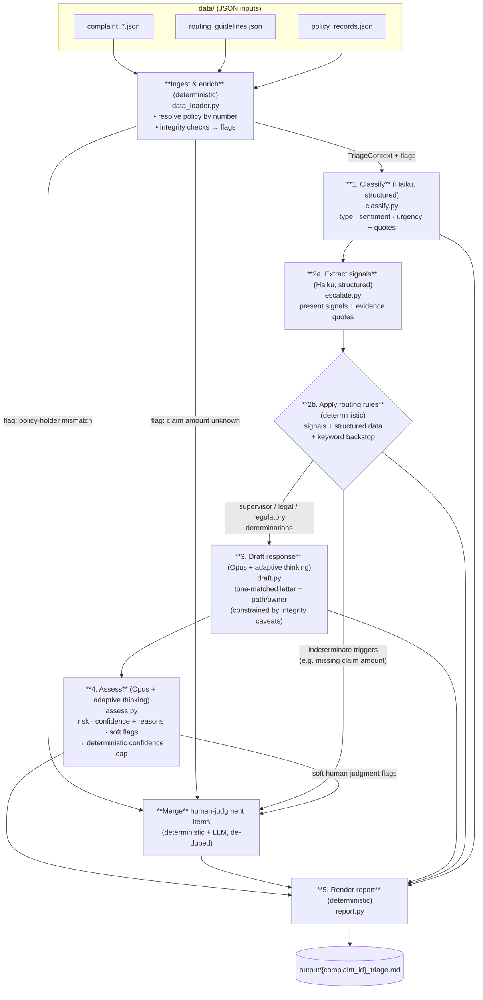

# Architecture — Complaint Triage Pipeline

A **hybrid prompt-chain**: the LLM does what it's good at (reading unstructured complaint
text — classification, evidence extraction, drafting, risk judgment), while **deterministic
Python owns every consequential decision** (applying the escalation rules, the
data-integrity checks, and assembling the report). We deliberately do not let a model
"decide" a regulatory or legal escalation when the rules are explicit and auditable.

## Flow

## Why this shape

| Concern | Decision |
| --- | --- |
| Escalation must be **auditable** | Rules applied in Python using trigger wording and thresholds from `routing_guidelines.json`; the LLM only supplies evidence (signals + quotes). |
| **Cost** | Fast, inexpensive Haiku for the structured extraction steps; Opus only for the two steps a human reads (draft + risk). |
| **Edge cases** must surface | Deterministic data-integrity checks (policy-holder mismatch, missing claim amount) are guaranteed to appear in the confidence + human-judgment sections, not dependent on the model noticing. |
| **Indeterminate ≠ false** | Triggers that can't be evaluated (e.g. no claim amount on a denied claim) are reported as *indeterminate* and routed to human judgment, never silently dropped. |
| **Missed signals** | A keyword backstop forces *needs review* when high-stakes keywords appear but the LLM didn't flag the covering signal. |
| **Don't over-promise** | The draft step receives the integrity caveats so it won't confirm coverage for an unverified identity. |

## Models

| Step | Model | Why |
| --- | --- | --- |
| Classify, extract signals | `claude-haiku-4-5` | Constrained structured output; fast and inexpensive at the high-frequency steps. |
| Draft response, assess risk/confidence | `claude-opus-4-8` (adaptive thinking) | Nuanced, human-facing generation and judgment where quality matters most. |
